<div align="center">



### The VLESS panel with a beautiful subscription page · Telegram bot · self-update

**English** · [فارسی 🇮🇷](#-رهگذر--rahgozar-1)

</div>

---

## 💡 What is Rahgozar?

**Rahgozar** (Persian for *the night traveler*) is a lightweight but complete control panel for personal or commercial proxy services:

1. The admin creates a **user** — quota in GB, expiry in days, concurrent-IP limit
2. Rahgozar issues a **personal subscription link**
3. The user imports it into any client (V2Box, Hiddify, Streisand…) and configs stay forever in sync
4. A gorgeous **subscription page** shows usage, expiry and QR codes, and recommends the right app for the visitor's phone with **real store links**
5. A **Telegram bot** runs sales and support without ever opening the panel

Every visual asset — logos, banners, diagrams, music — is **original artwork** made for this project.

## ✨ Features



| Area | Highlights |
|---|---|
| **Subscription page** | Journey-style usage card, per-config QR, Base64 copy-all, night/light themes, FA/EN, speed mode, optional per-user password |
| **Triple copy engine** | sync `execCommand` → Clipboard API → manual-copy modal — works even inside Telegram's in-app browser |
| **Recommended apps** | Real Google Play / App Store links with real icons, auto-detects Android vs iOS visitors |
| **Admin dashboard** | Glassmorphism night palette, two-column layout, live system/connection/bandwidth stats with sparklines |
| **Telegram bot** | user management, broadcast (≤3500 chars), instant backup, scheduled daily report |
| **Self-update** | `VERSION` chip vs latest GitHub tag, gold pulsing dot when outdated, one-click install with live log |

## 🏗 Architecture



| Component | File | Role |
|---|---|---|
| Core panel | `main.py` | FastAPI: auth, users, inbounds, config generator, VLESS relay, XHTTP module |
| Web proxy | `twp.py` | session-based HTTP/WS bridge |
| Tunnel manager | `tm.py` | remote nodes, heartbeat, auto-sync |
| Vercel relay | `vercel_relay.py` + `deploy/vercel/` | second-domain relaying, public-domain discovery |
| Notifications | `notif/` | event pipeline for the bot |
| CF worker | `worker/worker.js` | edge configs, synced from the panel |

State lives in a single JSON inside `DATA_DIR` (default `/data`), written atomically (tmp + rename).

## 🌍 Network map



## 🚀 Quick start

**Railway (recommended):** push the repo → *Deploy from GitHub* → attach a Volume on `/data` → set env vars. `railway.toml` + `Dockerfile` are ready.

**Docker:**
```bash
docker build -t rahgozar .
docker run -d --name rahgozar -p 8080:8080 -v rahgozar_data:/data rahgozar
```

**VPS:**
```bash
bash start.sh        # interactive installer (systemd service included)
```

| Env var | Default | Purpose |
|---|---|---|
| `ADMIN_USERNAME` / `ADMIN_PASSWORD` | `admin` / `admin` | panel login — **change immediately** |
| `UPDATE_REPO` | `your-username/Rahgozar` | `user/repo` used for versioning & auto-update |
| `UPDATE_BRANCH` | `main` | update source branch |
| `DATA_DIR` | `/data` | state & backups |
| `SECRET_KEY` | random | session signing key (keep equal across replicas) |

Health probe: `GET /healthz` → `{"ok": true, "version": "1.0.0", …}`

## 🏷 Versioning & auto-update



- The panel version comes from the **`VERSION` file** in the repo root; the topbar chip always displays it
- The panel polls the **latest tag/release** of `UPDATE_REPO` via the GitHub API and compares numerically (`v2.10 > v2.9`)
- Newer tag exists → pulsing gold dot on the chip + banner in Settings → **Install update** pulls the latest code with a live log
- Release flow: bump `VERSION` → push → (optionally cut a GitHub Release) → running panels figure it out themselves

## 📄 Subscription contract

| Public route | Purpose |
|---|---|
| `/p/{config_uuid}` | full subscription page |
| `/sub-group/{uuid_key}` | group subscription page |
| `/link/{uuid}` | Base64 export for direct import |
| `/link/{uuid}/qr` | QR of the link |

`GET /link/{uuid}` returns `username`, `config_uuid`, `status`, `configs[]`, `traffic_used/limit_bytes`, `traffic_percent`, `expire_days`, `max_ip_per_user`, `used_ips`, `transport_type`, `worker_configs[]`… Standard clients read quota/expiry from `Subscription-Userinfo` automatically.

## 🛰 Inbounds & protocols

| Type | Path | Use case |
|---|---|---|
| VLESS + WS + TLS | `/ws/{uuid}` | most compatible |
| XHTTP `packet-up` | `/xhttp-flow/packet-up/{uuid}` | flaky networks |
| XHTTP `stream-up` | `/xhttp-flow/stream-up/{uuid}` | high throughput |
| XHTTP `stream-one` | `/xhttp-flow/stream-one/{uuid}` | single bidirectional stream |
| Reality | — | hardened TLS camouflage, auto keygen |

Generated links are parser-friendly: `alpn` is fully percent-encoded and empty `fp=` values are omitted — the two classic reasons clients reject configs.

## 📱 Recommended clients

| Android | iOS |
|---|---|
| [Hiddify](https://play.google.com/store/apps/details?id=app.hiddify.com) · [sing-box](https://play.google.com/store/apps/details?id=io.nekohasekai.sfa) · [V2Box](https://play.google.com/store/apps/details?id=dev.hexasoftware.v2box) · [v2rayNG](https://github.com/2dust/v2rayNG/releases/latest) · [NekoBox](https://github.com/MatsuriDayo/NekoBoxForAndroid/releases/latest) | [V2Box](https://apps.apple.com/us/app/v2box-v2ray-client/id6446814690) · [Streisand](https://apps.apple.com/us/app/streisand/id6450534064) · [Hiddify](https://apps.apple.com/us/app/hiddify-proxy-utility/id6596777532) · [Shadowrocket](https://apps.apple.com/us/app/shadowrocket/id932747118) (paid) |

All verified — apps removed from Play (v2rayNG, NekoBox) point to their official GitHub releases.

## 🤖 Bot & backups

Bot token + admin id live in Settings: user CRUD with inline keyboards, broadcast, `/backup-now`, scheduled daily report, event notifications. State is one `data.json` — the bot can drop a fresh backup in your chat anytime; restore by placing the file and restarting.

## 🔌 API cheat-sheet

`POST /api/login {username,password}` · `GET /api/me` · `POST /api/change-password {current,new?,new_username?}` · `POST /api/panel-api-key/regenerate` (keys use the `rgz_` prefix, legacy keys auto-migrate) · `GET /api/settings/version` · `POST /api/settings/update` + `GET /api/settings/update/status` · `POST /api/bot/broadcast {text}` · `POST /api/bot/backup-now` — all cookie-authenticated except login.

## 🔁 Mirror to two GitHub accounts

Built by two developers? The ready-made workflow `.github/workflows/mirror-sync.yml` pushes every commit and tag to the second account automatically — see **[MIRROR.md](MIRROR.md)**.

---


---

<div align="center">



### پنل مدیریت و توزیع کانفیگ VLESS با صفحهٔ اشتراک زیبا · ربات تلگرام · بروزرسانی خودکار

[English 🇬🇧](#what-is-rahgozar) · **فارسی**

</div>

---

## 💡 رهگذر چیست؟

**رهگذر** پنلی سبک اما کامل برای ادارهٔ سرویس‌های پروکسی شخصی یا تجاری است:

1. مدیر **کاربر** می‌سازد — با حجم (گیگابایت)، مدت (روز) و سقف IP همزمان
2. رهگذر **لینک اشتراک اختصاصی** صادر می‌کند
3. کاربر لینک را در هر اپی (V2Box، Hiddify، Streisand و…) Import می‌کند و کانفیگ‌ها همیشه به‌روز می‌مانند
4. یک **صفحهٔ اشتراک زیبا** مصرف، انقضا و QR را نشان می‌دهد و اپ مناسب گوشی بازدیدکننده را با **لینک واقعی استور** پیشنهاد می‌دهد
5. **ربات تلگرام** فروش و پشتیبانی را بدون باز کردن پنل انجام می‌دهد

تمام assetهای بصری — لوگو، بنرها، نمودارها و موسیقی — **آثار اورجینال** ساخته‌شده برای همین پروژه‌اند.

## ✨ امکانات



| حوزه | نکته‌ها |
|---|---|
| **صفحهٔ اشتراک** | کارت سفر مصرف، QR هر کانفیگ، کپی همه به‌صورت Base64، تم شب/روز، دوزبانه، حالت سرعت، رمز اختیاری هر کاربر |
| **موتور کپی سه‌مرحله‌ای** | همگام → Clipboard API → مودال کپی دستی — حتی داخل مرورگر داخلی تلگرام کار می‌کند |
| **اپ‌های پیشنهادی** | لینک واقعی گوگل‌پلی/اپ‌استور با آیکون واقعی، با تشخیص خودکار اندروید/iOS |
| **داشبورد ادمین** | پالت شب شیشه‌ای، چیدمان دو‌ستونه، آمار زندهٔ سیستم/اتصال/پهنای‌باند با اسپارک‌لاین |
| **ربات تلگرام** | مدیریت کاربر، پیام همگانی (تا ۳۵۰۰ نویسه)، بکاپ فوری، گزارش روزانهٔ خودکار |
| **بروزرسانی خودکار** | چیپ `VERSION` در برابر آخرین تگ گیت‌هاب، نقطهٔ طلایی چشمک‌زن هنگام وجود نسخهٔ جدید، نصب با یک کلیک و لاگ زنده |

## 🏗 معماری



| مؤلفه | فایل | نقش |
|---|---|---|
| هستهٔ پنل | `main.py` | فست‌API: ورود، کاربران، اینباندها، مولد کانفیگ، رلهٔ VLESS، ماژول XHTTP |
| وب‌پروکسی | `twp.py` | بریج نشست‌دار HTTP/WS |
| مدیریت تونل | `tm.py` | نودهای راه‌دور، ضربان، همگام‌سازی خودکار |
| رلهٔ ورسل | `vercel_relay.py` + `deploy/vercel/` | دامنهٔ دوم و کشف دامنهٔ عمومی |
| اطلاع‌رسانی | `notif/` | خط لولهٔ رویدادها برای ربات |
| ورکر کلادفلر | `worker/worker.js` | کانفیگ لبه، همگام از پنل |

تمام وضعیت در یک JSON داخل `DATA_DIR` (پیش‌فرض `/data`) با نوشتن اتمی (tmp + rename) ذخیره می‌شود.

## 🌍 نقشهٔ شبکه



## 🚀 راه‌اندازی

**Railway (پیشنهادی):** ریپو را push کنید → *Deploy from GitHub* → یک Volume روی `/data` وصل کنید → متغیرها را تنظیم کنید. `railway.toml` و `Dockerfile` آماده‌اند.

**داکر:**
```bash
docker build -t rahgozar .
docker run -d --name rahgozar -p 8080:8080 -v rahgozar_data:/data rahgozar
```

**سرور شخصی:**
```bash
bash start.sh        # نصب‌کنندهٔ تعاملی همراه سرویس systemd
```

| متغیر | پیش‌فرض | کار |
|---|---|---|
| `ADMIN_USERNAME` / `ADMIN_PASSWORD` | `admin` / `admin` | ورود پنل — **فوراً عوض کنید** |
| `UPDATE_REPO` | `your-username/Rahgozar` | `user/repo` برای ورژن و آپدیت خودکار |
| `UPDATE_BRANCH` | `main` | شاخهٔ منبع آپدیت |
| `DATA_DIR` | `/data` | دیتا و بکاپ‌ها |
| `SECRET_KEY` | تصادفی | کلید امضای نشست (در چند رپلیکا یکسان) |

سلامت سرویس: `GET /healthz` → `{"ok": true, "version": "1.0.0", …}`

## 🏷 ورژن‌بندی و بروزرسانی خودکار



- ورژن پنل از **فایل `VERSION`** در ریشهٔ ریپو خوانده می‌شود؛ چیپ نوار بالا همیشه نمایشش می‌دهد
- پنل آخرین **تگ/ریلیز** ریپوی `UPDATE_REPO` را از API گیت‌هاب می‌گیرد و عددی مقایسه می‌کند (`v2.10 > v2.9`)
- تگ جدیدتر موجود باشد → نقطهٔ طلایی روی چیپ + بنر در تنظیمات → **نصب بروزرسانی** آخرین کد را با لاگ زنده نصب می‌کند
- گردش‌کار انتشار: `VERSION` را زیاد کنید → push → (اختیاری) Release بزنید → پنل‌های در حال اجرا خودشان می‌فهمند

## 📄 قرارداد اشتراک

| مسیر عمومی | کار |
|---|---|
| `/p/{config_uuid}` | صفحهٔ اشتراک کامل |
| `/sub-group/{uuid_key}` | صفحهٔ اشتراک گروهی |
| `/link/{uuid}` | خروجی Base64 برای Import مستقیم |
| `/link/{uuid}/qr` | QR لینک |

خروجی `/link/{uuid}` شامل `username`، `config_uuid`، `status`، `configs[]`، `traffic_used/limit_bytes`، `traffic_percent`، `expire_days`، `max_ip_per_user`، `used_ips`، `transport_type` و `worker_configs[]` است؛ اپ‌های استاندارد حجم/انقضا را از `Subscription-Userinfo` خودکار می‌خوانند.

## 🛰 اینباندها و پروتکل‌ها

| نوع | مسیر | کاربرد |
|---|---|---|
| VLESS + WS + TLS | `/ws/{uuid}` | سازگارترین حالت |
| XHTTP `packet-up` | `/xhttp-flow/packet-up/{uuid}` | شبکه‌های ناپایدار |
| XHTTP `stream-up` | `/xhttp-flow/stream-up/{uuid}` | پهنای‌باند بالا |
| XHTTP `stream-one` | `/xhttp-flow/stream-one/{uuid}` | تک‌استریم دوسویه |
| Reality | — | استتار TLS مقاوم با تولید خودکار کلید |

لینک‌های تولیدی برای پارسرها تمیزند: `alpn` کامل percent-encod شده و `fp=` خالی هرگز در لینک نمی‌آید — همان دو دلیل کلاسیک رد شدن کانفیگ در کلاینت‌ها.

## 📱 کلاینت‌های پیشنهادی

| اندروید | iOS |
|---|---|
| [Hiddify](https://play.google.com/store/apps/details?id=app.hiddify.com) · [sing-box](https://play.google.com/store/apps/details?id=io.nekohasekai.sfa) · [V2Box](https://play.google.com/store/apps/details?id=dev.hexasoftware.v2box) · [v2rayNG](https://github.com/2dust/v2rayNG/releases/latest) · [NekoBox](https://github.com/MatsuriDayo/NekoBoxForAndroid/releases/latest) | [V2Box](https://apps.apple.com/us/app/v2box-v2ray-client/id6446814690) · [Streisand](https://apps.apple.com/us/app/streisand/id6450534064) · [Hiddify](https://apps.apple.com/us/app/hiddify-proxy-utility/id6596777532) · [Shadowrocket](https://apps.apple.com/us/app/shadowrocket/id932747118) (پولی) |

همه راستی‌آزمایی شده‌اند؛ اپ‌های حذف‌شده از گوگل‌پلی (v2rayNG و NekoBox) به ریلیز رسمی گیت‌هاب وصل‌اند.

## 🤖 ربات و بکاپ

توکن ربات و شناسهٔ ادمین در تنظیمات: ساخت/ویرایش کاربر با کیبورد شیشه‌ای، پیام همگانی، «بکاپ فوری»، گزارش روزانهٔ زمان‌بندی‌شده و اطلاع‌رسانی رویدادها. کل وضعیت یک `data.json` است — ربات هر لحظه می‌تواند بکاپ تازه در چت شما بگذارد؛ بازیابی = گذاشتن فایل + ری‌استارت.

## 🔌 مرجع API

`POST /api/login {username,password}` · `GET /api/me` · `POST /api/change-password {current,new?,new_username?}` · `POST /api/panel-api-key/regenerate` (کلیدها با پیشوند `rgz_`، کلیدهای قدیمی خودکار مهاجرت می‌کنند) · `GET /api/settings/version` · `POST /api/settings/update` + `GET /api/settings/update/status` · `POST /api/bot/broadcast {text}` · `POST /api/bot/backup-now` — همه با کوکی، به‌جز ورود.

## 🔁 انتشار همزمان روی دو گیت‌هاب

دو سازنده دارید؟ ورک‌فلو آمادهٔ `.github/workflows/mirror-sync.yml` هر commit و تگ را خودکار به اکانت دوم هم push می‌کند — راهنما: **[MIRROR.md](MIRROR.md)**.

---


---
